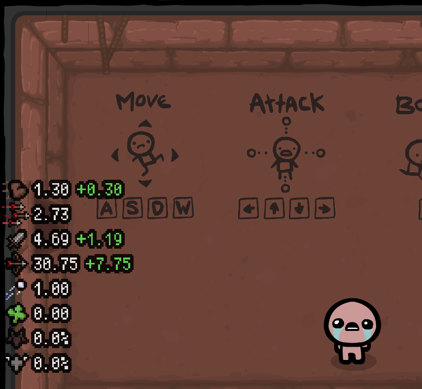
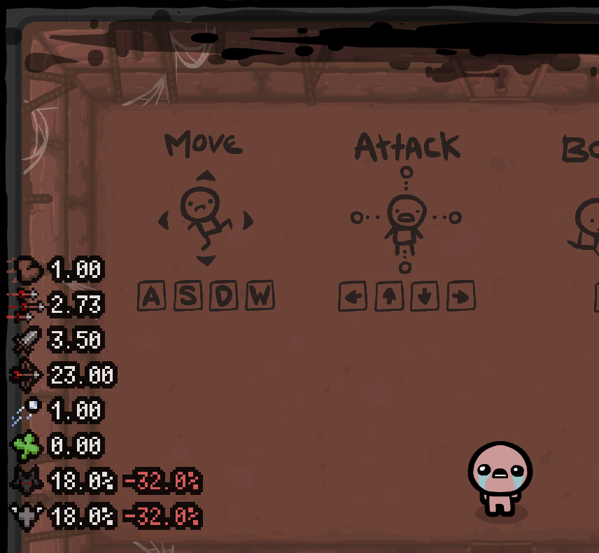
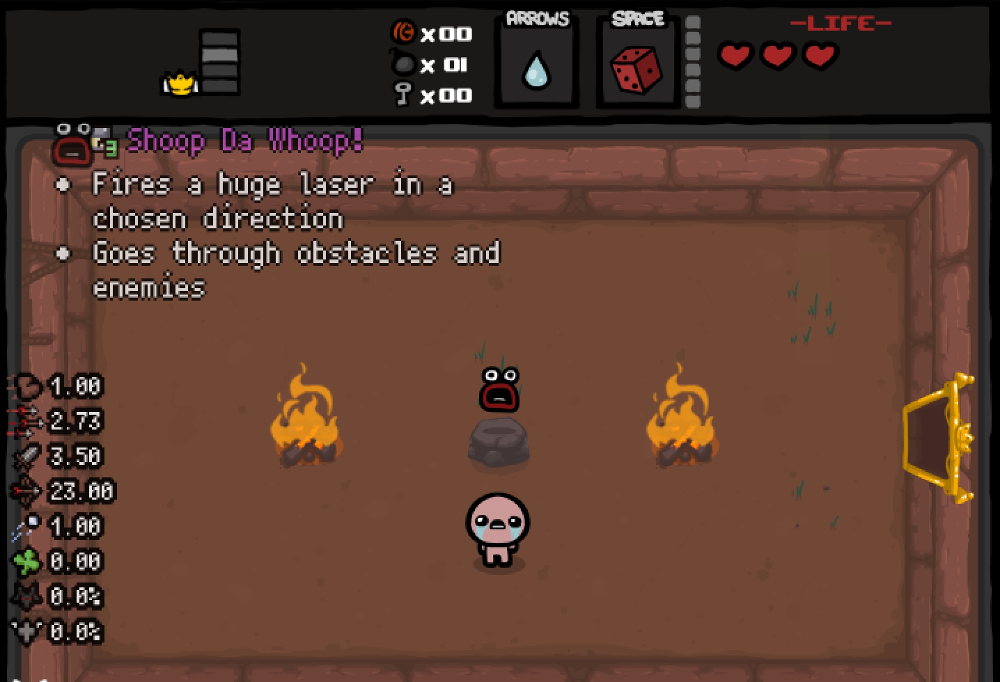

# Stats HUD for The Binding of Isaac (Flash)

**Press F3 to hide/show the stats!**

Shows Isaac's current stats on the left side of the screen in the original Flash game
([The Binding of Isaac](https://store.steampowered.com/app/113200/The_Binding_of_Isaac/),
including Wrath of the Lamb/Eternal DLC), like the stats HUD of Rebirth / Repentance:

speed, tears, damage, range, shot speed, luck, devil room chance and angel room chance.

When a stat changes, the difference is shown next to it for a moment (green up, red down).

Built the same way as [EID Flash](https://github.com/tomandesMSH/FlashTBoI-EID): a patcher builds the modded game from your own
copy, and both mods can be used together.

## Screenshots
| | |
|---|---|
|  |  |

## Features
- All values come from the game's own code: the same functions and variables the game uses for Isaac's tears, so
  every item, trinket, pill, card and character is included
- Devil and angel room chance for the current floor, using the game's own roll (taking damage, killing a beggar,
  Pentagram, recent devil rooms...)
- Stat change indicators
- Works together with EID Flash

## Installation
No game files are distributed. The patcher builds the modded game from your own copy:

1. Download `Stats_HUD_Patcher.exe` from the [latest release](https://github.com/tomandesMSH/FlashTBoI-StatsHUD/releases/latest) and put it in the folder where you want to keep the game.
2. Double-click it. A game window appears for a few seconds while it reads your game, then the patcher creates a
   `Stats HUD` folder next to itself (and downloads Adobe's Flash Player 32 projector into it).
3. At the end it shows a launch option (and copies it to your clipboard). Paste it into Steam: right-click
   The Binding of Isaac > Properties > General > **Launch Options**. Steam's **Play** button then starts Stats HUD.
   Or start the game with `Stats HUD\Stats HUD.exe`.

**With other mods:** the easiest way is the [TBoI Flash Mods](https://github.com/tomandesMSH/FlashTBoI-Mods/releases/latest)
installer: tick the mods you want, and it installs the newest version of each. Or install EID Flash first, then run
the patcher on its result:

    Stats_HUD_Patcher.exe --swf "EID Flash\isaac_eid.swf"

The `Stats HUD` folder then has the game with both mods; use its launch option.

Prefer not to run an exe? The zip has the plain Python script (`python stats_hud_patcher.py --get-projector`).

Details: [`flash/patcher/README.txt`](flash/patcher/README.txt). Development and technical notes:
[`flash/README.md`](flash/README.md).

## Other mods
- [EID Flash](https://github.com/tomandesMSH/FlashTBoI-EID): descriptions for items, trinkets, cards and pills
- [Debug Console](https://github.com/tomandesMSH/FlashTBoI-DebugConsole): Repentance's debug console (giveitem, spawn, goto, ...)
- [TBoI Flash Mods](https://github.com/tomandesMSH/FlashTBoI-Mods/releases/latest): installer for all of them

## Credits
See [CREDITS.md](CREDITS.md).
